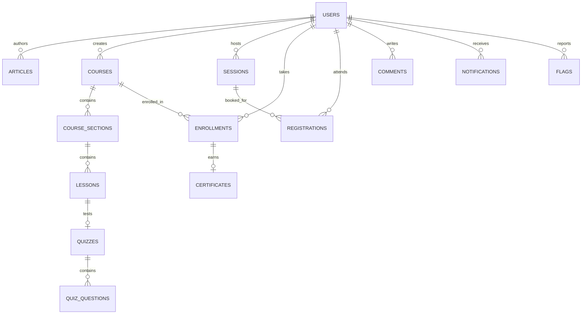

# TES Knowledge Hub — Complete Backend API Specification & Blueprint

This document specifies the complete backend API required to power the **TES-Hub** frontend application (`TES-Hub-main`).

---

## 📌 1. Project Overview & Architecture

* **Frontend Stack**: React 19, TypeScript, Vite, Tailwind CSS v4, Zustand (`authStore`, `notificationStore`, `toastStore`), Axios (`baseURL: "/api"`), TanStack React Query.
* **Current State**: Frontend was designed to run client-side against **Mock Service Worker (MSW)**. All API routes are prefixed with `/api`.
* **Backend Objective**: Build a robust RESTful API (e.g. Node.js / Express + PostgreSQL) that provides full persistence, authentication, role-based access control, file storage, and business logic.
* **Authentication Scheme**: JWT Bearer Token passed via HTTP Header:  
  `Authorization: Bearer <token>`

---

## 👥 2. User Roles & Permissions

The platform defines 6 distinct user roles (`Role`):
1. `guest`: Unauthenticated visitor (can browse public content).
2. `member`: Standard authenticated user (can read, comment, save, like, enroll, register for sessions).
3. `verified_farmer`: Verified agricultural practitioner (member perks + verified badge).
4. `spac_consultant`: Agricultural consultant / advisor (can author and advise).
5. `tes_author`: Content creator (can draft and publish articles, courses, stories).
6. `tes_admin`: Full administrative privileges (moderation, flags, user ban/role management, session creation).

---

## 📊 3. Master API Endpoints Chart

Below is the exhaustive catalog of all **47 endpoints** organized across 10 functional modules.

### Module 1: Authentication & Account Recovery (`/api/auth`)

| Method | Endpoint | Access | Request Body | Response (Success / Error) | Description |
|---|---|---|---|---|---|
| **POST** | `/api/auth/signup` | Public | `{ fullname, username, email, password }` | `201 Created` / `400 Bad Request` | Registers a new user account; sends email verification code. |
| **POST** | `/api/auth/verify-email` | Public | `{ email, code }` | `200 OK`: `{ token, user }` `400 Bad Request`: `{ message: "Invalid or expired code." }` | Verifies 6-digit code. Returns JWT token and User profile. |
| **POST** | `/api/auth/login` | Public | `{ email, password }` | `200 OK`: `{ token, user }` `401 Unauthorized`: `{ message: "Invalid email or password." }` | Authenticates user with credentials. |
| **POST** | `/api/auth/forgot-password` | Public | `{ email }` | `200 OK` | Sends password reset 6-digit code to the user's email. |
| **POST** | `/api/auth/verify-reset-code` | Public | `{ email, code }` | `200 OK` `400 Bad Request`: `{ message: "Invalid or expired code." }` | Validates 6-digit reset code before password form. |
| **POST** | `/api/auth/reset-password` | Public | `{ email, code, password }` | `200 OK` `400 Bad Request`: `{ message: "Reset code is invalid or expired." }` | Updates user password after code verification. |
| **POST** | `/api/auth/resend-verification` | Public | `{ email }` | `200 OK` | Re-generates and re-sends 6-digit verification code. |

---

### Module 2: User Profile & Account Settings (`/api/profile`, `/api/settings`, `/api/authors`)

| Method | Endpoint | Access | Params / Body | Response Output | Description |
|---|---|---|---|---|---|
| **GET** | `/api/profile/:id` | Public | Param: `id` | `200 OK`: `User` object `404 Not Found` | Retrieves public profile of any user by ID. |
| **PATCH** | `/api/profile/me` | Authenticated | Body: Partial `User` `{ displayName?, username?, bio?, avatar?, region?, languages?, interests? }` | `200 OK`: Updated `User` object | Updates authenticated user's profile details and onboarding data. |
| **DELETE** | `/api/profile/me` | Authenticated | None | `204 No Content` | Permanently deletes authenticated user account. |
| **GET** | `/api/authors/:username` | Public | Param: `username` | `200 OK`: `User` `404 Not Found` | Retrieves author profile and published contributions by username. |
| **GET** | `/api/users` | Authenticated | None | `200 OK`: `[{ id, name, lastName }]` | Returns minimal user list for mentions and dropdowns. |
| **GET** | `/api/settings/me` | Authenticated | Query: `?id=:userId` | `200 OK`: `UserSettings` `{ contentLanguages, notifications, privacy }` | Retrieves user's notification and privacy settings. |
| **PATCH** | `/api/settings/me` | Authenticated | Body: `{ id?, contentLanguages?, notifications?, privacy? }` | `200 OK`: Updated `UserSettings` | Updates language preferences, email alerts, privacy options. |
| **POST** | `/api/settings/password` | Authenticated | Body: `{ currentPassword, newPassword }` | `204 No Content` `400 Bad Request`: `{ message: "..." }` | Changes password for authenticated account. |

---

### Module 3: Academy Articles (`/api/articles`)

| Method | Endpoint | Access | Params / Body | Response Output | Description |
|---|---|---|---|---|---|
| **GET** | `/api/articles` | Public | None | `200 OK`: `Article[]` | Retrieves all published/accessible articles. |
| **GET** | `/api/articles/:slug` | Public | Param: `slug` | `200 OK`: `Article` `404 Not Found` | Retrieves a single article by unique SEO slug. |
| **POST** | `/api/articles` | Author / Admin | Body: `{ title, body, category, slug?, excerpt?, topicTags?, coverImage?, status?, language? }` | `201 Created`: `Article` `409 Conflict`: Slug already exists | Creates a new article (draft or published). Auto-computes `readTimeMinutes`. |
| **PUT** | `/api/articles/:slug` | Author / Admin | Param: `slug` Body: Updated article fields | `200 OK`: Updated `Article` `404 Not Found` | Full update of existing article. |
| **PATCH** | `/api/articles/:slug/status` | Author / Admin | Param: `slug` Body: `{ status: "draft" \| "pending_review" \| "published" \| "rejected" \| "archived" }` | `200 OK`: Updated `Article` `404 Not Found` | Changes publishing workflow status of an article. |

---

### Module 4: Academy Courses (`/api/courses`)

| Method | Endpoint | Access | Params / Body | Response Output | Description |
|---|---|---|---|---|---|
| **GET** | `/api/courses` | Public | None | `200 OK`: `Course[]` | Returns list of academy courses with modules and pricing. |
| **GET** | `/api/courses/:slug` | Public | Param: `slug` | `200 OK`: `Course` `404 Not Found` | Returns full course curriculum, sections, lessons, and quizzes. |
| **POST** | `/api/courses` | Author / Admin | Body: `Partial<Course>` (must have `title`) | `201 Created`: `Course` `409 Conflict`: Duplicate slug | Creates a new course draft with curriculum sections. |
| **PATCH** | `/api/courses/:slug` | Author / Admin | Param: `slug` Body: `Partial<Course>` | `200 OK`: Updated `Course` `404 Not Found` | Updates course metadata, sections, lessons, or pricing. |
| **PATCH** | `/api/courses/:slug/status` | Author / Admin | Param: `slug` Body: `{ status: EntityStatus }` | `200 OK`: Updated `Course` `404 Not Found` | Updates status (e.g., publish course, set live). |
| **DELETE** | `/api/courses/:slug` | Admin | Param: `slug` | `200 OK`: Deleted `Course` `404 Not Found` | Removes or unpublishes course from academy catalog. |

---

### Module 5: Learning Engine, Quizzes, Certificates & Resources

| Method | Endpoint | Access | Params / Body | Response Output | Description |
|---|---|---|---|---|---|
| **GET** | `/api/enrollments` | Authenticated | Query: `?userId=:userId` | `200 OK`: `Enrollment[]` | Returns all active course enrollments for the user. |
| **GET** | `/api/courses/:slug/enrollment` | Authenticated | Param: `slug` Query: `?userId=:userId` | `200 OK`: `Enrollment` `404 Not Found`: Not enrolled | Checks user enrollment status and lesson progress for a course. |
| **POST** | `/api/courses/:slug/enroll` | Authenticated | Param: `slug` Body: `{ userId?: string }` | `201 Created`: `Enrollment` `409 Conflict`: Course full | Enrolls user into course; checks capacity and creates enrollment state. |
| **POST** | `/api/courses/:slug/progress` | Authenticated | Param: `slug` Body: `{ lessonId, completed: boolean, userId? }` | `200 OK`: `Enrollment` `409 Conflict`: Quiz prerequisite not passed | Marks lesson complete/incomplete; re-calculates `progressPercent` and triggers certificate if threshold met. |
| **GET** | `/api/quizzes/:quizId` | Authenticated | Param: `quizId` Query: `?userId=:userId` | `200 OK`: `PublicQuiz` (omits correct answers) | Returns public quiz questions for test-taker without giving away answer keys. |
| **POST** | `/api/quizzes/:quizId/attempts` | Authenticated | Param: `quizId` Body: `{ answers: Record<string, string[]>, userId? }` | `201 Created`: `{ attempt: QuizAttempt, enrollment: Enrollment }` `409 Conflict`: Max attempts exceeded | Grades quiz attempt, tracks score, and unlocks lesson completion if passed. |
| **GET** | `/api/courses/:slug/certificate` | Authenticated | Param: `slug` Query: `?userId=:userId` | `200 OK`: `Certificate` `409 Conflict`: Course not yet completed | Retrieves issued course completion certificate with score. |
| **GET** | `/api/certificates/verify/:code` | Public | Param: `code` (e.g. `TES-CROP-2026-X89A12`) | `200 OK`: `Certificate` `404 Not Found`: Invalid code | Public certificate validation page for employers / partners. |
| **GET** | `/api/resources` | Public | None | `200 OK`: `Resource[]` | Returns downloadable guides, spreadsheets, and manuals. |
| **POST** | `/api/resources/:id/download` | Public | Param: `id` | `200 OK`: `Resource` with incremented `downloadCount` | Tracks download metrics for analytics. |

---

### Module 6: Sessions, Webinars & Field Days (`/api/sessions`)

| Method | Endpoint | Access | Params / Body | Response Output | Description |
|---|---|---|---|---|---|
| **GET** | `/api/sessions` | Public | None | `200 OK`: `Session[]` | Returns all upcoming/past webinars, field clinics, and workshops. |
| **GET** | `/api/sessions/:slug` | Public | Param: `slug` | `200 OK`: `Session` `404 Not Found` | Returns full session details, schedule agenda, materials, and host info. |
| **POST** | `/api/sessions` | Admin | Body: `Partial<Session>` (must have `title`, `slug`) | `201 Created`: `Session` `409 Conflict`: Duplicate slug | Creates a new webinar/event session. |
| **PATCH** | `/api/sessions/:slug` | Admin | Param: `slug` Body: `Partial<Session>` | `200 OK`: Updated `Session` | Modifies venue, timing, description, agenda, or materials. |
| **PATCH** | `/api/sessions/:slug/status` | Admin | Param: `slug` Body: `{ status: string }` | `200 OK`: Updated `Session` | Changes session visibility / lifecycle status. |
| **POST** | `/api/sessions/:slug/cancel` | Admin | Param: `slug` | `200 OK`: `Session` (`isCanceled: true`) | Cancels session and notifies attendees. |
| **POST** | `/api/sessions/:slug/restore` | Admin | Param: `slug` | `200 OK`: `Session` (`isCanceled: false`) | Restores a previously canceled session. |
| **DELETE** | `/api/sessions/:slug` | Admin | Param: `slug` | `200 OK`: Deleted `Session` | Deletes session record. |
| **GET** | `/api/sessions/:slug/registration` | Authenticated | Param: `slug` Query: `?userId=:userId` | `200 OK`: `Registration` `404 Not Found`: Not registered | Checks user's registration and ticket status. |
| **POST** | `/api/sessions/:slug/register` | Authenticated | Param: `slug` Body: `{ fullName, email, phone, notes?, userId? }` | `201 Created`: `Registration` `409 Conflict`: Already registered / Session full | Registers attendee for session, increments `registeredCount`. |
| **POST** | `/api/sessions/:slug/checkout` | Authenticated | Param: `slug` Body: `{ userId?: string }` | `200 OK`: `Registration` (`paymentStatus: "paid"`) | Confirms payment for paid sessions and unlocks access. |
| **DELETE** | `/api/sessions/:slug/register` | Authenticated | Param: `slug` Query: `?userId=:userId` | `200 OK`: Cancelled `Registration` | Cancels attendance and releases held seat. |

---

### Module 7: Community Feed (Stories, Questions, Comments & Likes)

| Method | Endpoint | Access | Params / Body | Response Output | Description |
|---|---|---|---|---|---|
| **GET** | `/api/stories` | Public | None | `200 OK`: `Story[]` | Community stories feed from farmers and specialists. |
| **GET** | `/api/stories/:slug` | Public | Param: `slug` | `200 OK`: `Story` `404 Not Found` | Detail page for a farmer story. |
| **POST** | `/api/stories/:slug/:metric` | Authenticated | Param: `slug`, `metric` (`like` \| `save`) Query: `?undo=true` | `200 OK`: Updated `Story` stats | Likes or bookmarks a community story. |
| **GET** | `/api/questions` | Public | None | `200 OK`: `Question[]` | Q&A forum feed for crop issues, livestock queries, etc. |
| **GET** | `/api/questions/:slug` | Public | Param: `slug` | `200 OK`: `Question` `404 Not Found` | Detailed question discussion thread. |
| **POST** | `/api/questions/:slug/:metric` | Authenticated | Param: `slug`, `metric` (`like` \| `save`) Query: `?undo=true` | `200 OK`: Updated `Question` stats | Likes or saves a Q&A question. |
| **GET** | `/api/comments` | Public | Query: `?contentId=:contentId` | `200 OK`: `Comment[]` | Lists all comments and threaded replies for a post/article. |
| **POST** | `/api/comments` | Authenticated | Body: `{ contentId, body, parentId?, authorId? }` | `201 Created`: `Comment` | Posts a new comment or reply; increments content comment counters. |
| **POST** | `/api/comments/:id/like` | Authenticated | Param: `id` | `200 OK`: Updated `Comment` (`likes += 1`) | Upvotes a comment or answer. |

---

### Module 8: In-App Notifications (`/api/notifications`)

| Method | Endpoint | Access | Params / Body | Response Output | Description |
|---|---|---|---|---|---|
| **GET** | `/api/notifications` | Authenticated | Query: `?userId=:userId&unread=true` | `200 OK`: `Notification[]` | Lists notifications (content alerts, replies, bookings). |
| **PATCH** | `/api/notifications/:id/read` | Authenticated | Param: `id` Body: `{ isRead?: boolean }` | `200 OK`: `Notification` | Marks an individual notification as read or unread. |
| **POST** | `/api/notifications/read-all` | Authenticated | Query: `?userId=:userId` | `200 OK`: `Notification[]` | Marks all notifications read for the current user. |
| **DELETE** | `/api/notifications/:id` | Authenticated | Param: `id` | `200 OK`: Deleted `Notification` | Dismisses and deletes a notification. |

---

### Module 9: Admin Dashboard & Moderation (`/api/admin`)

| Method | Endpoint | Access | Params / Body | Response Output | Description |
|---|---|---|---|---|---|
| **GET** | `/api/admin/flags` | Admin | None | `200 OK`: `Flag[]` | Lists all reported content flags (spam, offensive, etc.). |
| **PATCH** | `/api/admin/flags/:id` | Admin | Param: `id` Body: `{ status: "pending" \| "dismissed" \| "actioned" }` | `200 OK`: Updated `Flag` | Resolves, dismisses, or actions a content moderation report. |
| **GET** | `/api/admin/users` | Admin | None | `200 OK`: `User[]` | Lists all registered members, roles, and status for admin table. |
| **PATCH** | `/api/admin/users/:id` | Admin | Param: `id` Body: `{ role?: Role, isBanned?: boolean }` | `200 OK`: Updated `User` | Updates user role (e.g. promote to `verified_farmer`) or bans user. |

---

### Module 10: Contact Us & Inquiries (`/api/contact`)

| Method | Endpoint | Access | Params / Body | Response Output | Description |
|---|---|---|---|---|---|
| **POST** | `/api/contact` | Public | Body: `{ name, email, subject, message }` | `200 OK`: `{ id, status: "received", receivedAt, ... }` | Stores contact inquiry and triggers email alert to admins. |

---

## 🗄️ 4. Recommended PostgreSQL Database Schema

To support these 47 endpoints, the PostgreSQL database should contain the following normalized relational tables:

### Table Definitions:

1. **`users`**:
   - `id VARCHAR PRIMARY KEY`, `email VARCHAR UNIQUE NOT NULL`, `password_hash VARCHAR NOT NULL`
   - `username VARCHAR UNIQUE NOT NULL`, `display_name VARCHAR NOT NULL`, `avatar VARCHAR`
   - `role VARCHAR DEFAULT 'member'`, `bio TEXT`, `is_email_verified BOOLEAN DEFAULT false`
   - `is_banned BOOLEAN DEFAULT false`, `languages TEXT[]`, `interests TEXT[]`
   - `region_oblast VARCHAR`, `region_raion VARCHAR`, `region_village VARCHAR`
   - `created_at TIMESTAMP DEFAULT NOW()`

2. **`user_settings`**:
   - `user_id VARCHAR PRIMARY KEY REFERENCES users(id) ON DELETE CASCADE`
   - `content_languages TEXT[] DEFAULT ARRAY['ru']`
   - `email_replies BOOLEAN DEFAULT true`, `email_sessions BOOLEAN DEFAULT true`
   - `email_courses BOOLEAN DEFAULT false`, `email_newsletter BOOLEAN DEFAULT false`
   - `public_profile BOOLEAN DEFAULT true`, `show_region BOOLEAN DEFAULT true`, `allow_messages BOOLEAN DEFAULT true`

3. **`articles`**:
   - `id VARCHAR PRIMARY KEY`, `slug VARCHAR UNIQUE NOT NULL`, `title VARCHAR NOT NULL`
   - `author_id VARCHAR REFERENCES users(id)`, `category VARCHAR NOT NULL`
   - `body TEXT NOT NULL`, `excerpt TEXT`, `cover_image VARCHAR`
   - `status VARCHAR DEFAULT 'draft'`, `visibility VARCHAR DEFAULT 'public'`, `language VARCHAR DEFAULT 'en'`
   - `read_time_minutes INT DEFAULT 1`, `views INT DEFAULT 0`, `likes INT DEFAULT 0`, `comments_count INT DEFAULT 0`, `saves INT DEFAULT 0`
   - `topic_tags TEXT[]`, `created_at TIMESTAMP DEFAULT NOW()`, `updated_at TIMESTAMP DEFAULT NOW()`, `published_at TIMESTAMP`

4. **`courses`**:
   - `id VARCHAR PRIMARY KEY`, `slug VARCHAR UNIQUE NOT NULL`, `title VARCHAR NOT NULL`
   - `author_id VARCHAR REFERENCES users(id)`, `category VARCHAR NOT NULL`
   - `short_description TEXT`, `long_description TEXT`, `level VARCHAR DEFAULT 'beginner'`
   - `estimated_duration_hours NUMERIC DEFAULT 0`, `rating NUMERIC DEFAULT 0`, `review_count INT DEFAULT 0`
   - `status VARCHAR DEFAULT 'draft'`, `visibility VARCHAR DEFAULT 'hidden'`, `language VARCHAR DEFAULT 'en'`
   - `pricing_model VARCHAR DEFAULT 'free'`, `price_amount NUMERIC DEFAULT 0`, `currency VARCHAR DEFAULT 'KGS'`
   - `completion_threshold_percent INT DEFAULT 80`, `certificate_template VARCHAR`, `enrollment_limit INT`
   - `enrollment_count INT DEFAULT 0`, `topic_tags TEXT[]`, `cover_image VARCHAR`
   - `created_at TIMESTAMP DEFAULT NOW()`, `updated_at TIMESTAMP DEFAULT NOW()`, `published_at TIMESTAMP`

5. **`course_sections` & `lessons`**:
   - `sections`: `id VARCHAR PRIMARY KEY`, `course_id VARCHAR REFERENCES courses(id) ON DELETE CASCADE`, `title VARCHAR`, `order_index INT`
   - `lessons`: `id VARCHAR PRIMARY KEY`, `section_id VARCHAR REFERENCES course_sections(id) ON DELETE CASCADE`, `title VARCHAR`, `kind VARCHAR` (`text` \| `video` \| `quiz`), `content JSONB`, `duration_minutes INT`, `order_index INT`

6. **`quizzes` & `quiz_attempts`**:
   - `quizzes`: `id VARCHAR PRIMARY KEY`, `course_id VARCHAR REFERENCES courses(id)`, `lesson_id VARCHAR`, `title VARCHAR`, `pass_score_percent INT DEFAULT 80`, `max_attempts INT`, `questions JSONB`
   - `quiz_attempts`: `id VARCHAR PRIMARY KEY`, `quiz_id VARCHAR REFERENCES quizzes(id)`, `user_id VARCHAR REFERENCES users(id)`, `score_percent INT`, `passed BOOLEAN`, `answers JSONB`, `submitted_at TIMESTAMP DEFAULT NOW()`

7. **`enrollments` & `certificates`**:
   - `enrollments`: `id VARCHAR PRIMARY KEY`, `user_id VARCHAR REFERENCES users(id)`, `course_id VARCHAR REFERENCES courses(id)`, `progress_percent INT DEFAULT 0`, `completed_lesson_ids TEXT[]`, `quiz_state JSONB`, `enrolled_at TIMESTAMP DEFAULT NOW()`, `completed_at TIMESTAMP`
   - `certificates`: `id VARCHAR PRIMARY KEY`, `verification_code VARCHAR UNIQUE NOT NULL`, `user_id VARCHAR REFERENCES users(id)`, `course_id VARCHAR REFERENCES courses(id)`, `score_percent INT`, `issued_at TIMESTAMP DEFAULT NOW()`

8. **`sessions` & `registrations`**:
   - `sessions`: `id VARCHAR PRIMARY KEY`, `slug VARCHAR UNIQUE NOT NULL`, `title VARCHAR NOT NULL`, `host_id VARCHAR REFERENCES users(id)`, `format VARCHAR`, `session_type VARCHAR`, `description TEXT`, `starts_at TIMESTAMP`, `ends_at TIMESTAMP`, `capacity INT DEFAULT 0`, `registered_count INT DEFAULT 0`, `pricing_model VARCHAR DEFAULT 'free'`, `price_amount NUMERIC DEFAULT 0`, `agenda JSONB`, `materials JSONB`, `is_canceled BOOLEAN DEFAULT false`, `status VARCHAR DEFAULT 'draft'`
   - `registrations`: `id VARCHAR PRIMARY KEY`, `user_id VARCHAR REFERENCES users(id)`, `session_id VARCHAR REFERENCES sessions(id)`, `attendee_name VARCHAR`, `attendee_email VARCHAR`, `attendee_phone VARCHAR`, `notes TEXT`, `payment_status VARCHAR DEFAULT 'free'`, `check_in_status VARCHAR DEFAULT 'not_checked_in'`, `registered_at TIMESTAMP DEFAULT NOW()`

9. **`community_posts` (Stories & Questions)**:
   - `id VARCHAR PRIMARY KEY`, `type VARCHAR NOT NULL` (`story` \| `question`), `slug VARCHAR UNIQUE NOT NULL`, `title VARCHAR NOT NULL`, `author_id VARCHAR REFERENCES users(id)`, `body TEXT NOT NULL`, `topic_tags TEXT[]`, `views INT DEFAULT 0`, `likes INT DEFAULT 0`, `saves INT DEFAULT 0`, `comments_count INT DEFAULT 0`, `created_at TIMESTAMP DEFAULT NOW()`

10. **`comments`**:
    - `id VARCHAR PRIMARY KEY`, `content_id VARCHAR NOT NULL`, `parent_id VARCHAR REFERENCES comments(id) ON DELETE CASCADE`, `author_id VARCHAR REFERENCES users(id)`, `body TEXT NOT NULL`, `likes INT DEFAULT 0`, `is_hidden BOOLEAN DEFAULT false`, `created_at TIMESTAMP DEFAULT NOW()`

11. **`notifications`**:
    - `id VARCHAR PRIMARY KEY`, `user_id VARCHAR REFERENCES users(id) ON DELETE CASCADE`, `type VARCHAR NOT NULL`, `title VARCHAR NOT NULL`, `body TEXT NOT NULL`, `link VARCHAR`, `is_read BOOLEAN DEFAULT false`, `created_at TIMESTAMP DEFAULT NOW()`

12. **`flags` (Moderation)**:
    - `id VARCHAR PRIMARY KEY`, `content_id VARCHAR NOT NULL`, `content_type VARCHAR NOT NULL`, `reporter_id VARCHAR REFERENCES users(id)`, `reason VARCHAR NOT NULL`, `message TEXT`, `status VARCHAR DEFAULT 'pending'`, `created_at TIMESTAMP DEFAULT NOW()`

13. **`contact_inquiries`**:
    - `id VARCHAR PRIMARY KEY`, `name VARCHAR NOT NULL`, `email VARCHAR NOT NULL`, `subject VARCHAR NOT NULL`, `message TEXT NOT NULL`, `received_at TIMESTAMP DEFAULT NOW()`

---

## 🚀 5. Recommended Implementation Roadmap

1. **Phase 1: Project Setup & Core Database**
   - Initialize clean Express backend folder structure (e.g. `routes/`, `controllers/`, `middleware/`, `db/`).
   - Setup PostgreSQL database connection (using the Neon URL) with automatic table migrations.
2. **Phase 2: Authentication & User System**
   - Implement `auth.routes.ts` (Signup, Login, JWT issuing, bcrypt password hashing, 6-digit code generation).
   - Implement `/profile` and `/settings` endpoints.
3. **Phase 3: Academy Modules**
   - Implement Articles CRUD & status workflow.
   - Implement Courses, Curriculum Sections, Lessons, and Quizzes grading logic.
   - Implement Enrollments, Progress tracking, and Certificate generation with verification codes.
4. **Phase 4: Sessions & Community Engine**
   - Implement Sessions, Registration capacity locking, and checkout simulation.
   - Implement Stories, Questions, Comments, and Engagement metrics (`likes`, `saves`).
5. **Phase 5: Notifications & Admin Control**
   - Implement user notification triggers.
   - Implement Admin moderation dashboard endpoints (`/admin/flags`, `/admin/users`).
6. **Phase 6: Frontend Integration**
   - In `TES-Hub-main/src/main.tsx`, disable `enableMocking()` (MSW) to let the frontend connect directly to the live backend on `/api`!
